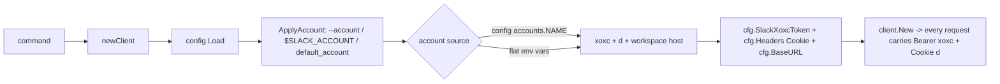
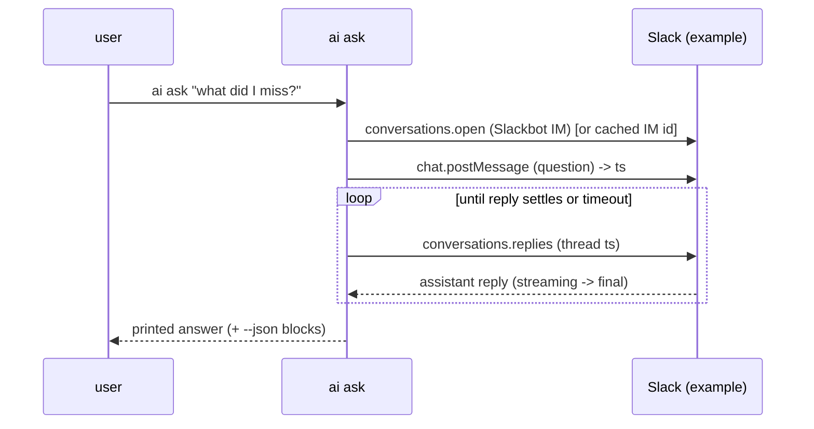
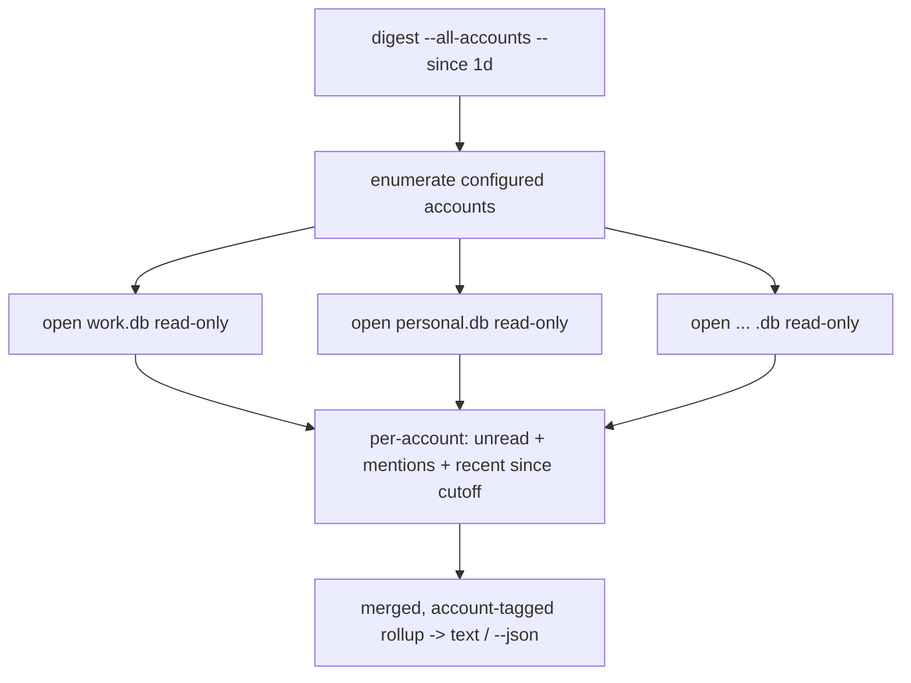

# feat: slack-cookie remaining build

## Summary

slack-cookie is a Go CLI that drives Slack as the user via their browser session (`xoxc` token + `d` cookie) instead of an OAuth app. The generated scaffold plus a hand-wired composed-auth layer is built and **verified live against the example workspace** (auth.test ok, conversations/search/history all return real data). This plan covers the remaining work to make it daily-usable and shippable: persistent multi-account auth, hardening the local SQLite sync the offline features depend on, the nine approved novel features (including native Slack AI access), and the verification pass.

Out of scope: the OAuth/app-token path (a separate published CLI), admin/enterprise-grid management, and publishing to the public Printing Press library (a later, user-triggered step).

## Problem Frame

Today the CLI authenticates only through three exported env vars and a single implicit account; nothing persists, and the offline/agent-native value proposition (cross-workspace digests, offline search) does not yet work because sync does not reliably store rows. The user has multiple **separate-login** Slack workspaces and wants to act across all of them, ask Slack's AI from the terminal, and run cheap repeated queries without re-hitting the rate-limit-sensitive web API. The composed-auth foundation is proven; the work is to build the durable layers on top of it.

## Key Technical Decisions

- **KTD1 — Composed auth via the transient config, no client template edits.** The generated client already sends every `cfg.Headers` entry and uses `cfg.BaseURL` as the host on every request. `config.ApplyAccount` (already built) populates `SlackXoxcToken`, `Headers["Cookie"]`, and `BaseURL` per active account on the transient config built in `newClient()`. All account work continues through this seam; `internal/client/client.go` is not edited. Rationale: survives `generate --force` regen, and keeps secrets out of the **live request** config (the transient config is never saved). Note: persistent multi-account auth (U1) does write credentials to disk — per the secrets-at-rest decision in U1 those live in the generated out-of-config credentials file (or OS keychain), never in `config.toml` — so this "off disk" property describes the in-memory request path, not the persisted account store.
- **KTD2 — One SQLite file per account.** Separate-login workspaces must not share a mirror. A new `accountDBPath(account)` resolves `<data-dir>/<account>.db`; sync writes the active account's DB and cross-account commands open each account's DB read-only. Rationale: clean isolation, makes cross-workspace fan-out a simple multi-open, avoids a tenant-column rewrite of the generated store.
- **KTD3 — `ai ask` rides documented methods; the other AI commands are defensive.** `ai ask` posts to the Slackbot IM via `chat.postMessage` and polls `conversations.replies` — both documented, robust. `ai search` (`search.inline`), `ai recap` (`ai.alpha.digest.*`), and `ai skills` (`ai.alpha.slackbot.skills.listEnabled`) are undocumented internals discovered by live sniff; build them now but isolate each behind its own sibling client call that degrades to a clear "Slack AI not available here" on non-2xx / `ok:false` rather than erroring. **These three were captured by method name only (n=1 sniff, no request/response bodies), so their call/return shapes are unverified — capture a targeted HAR of `search.inline` and at least one `ai.alpha.*` call before implementing U7/U8, and gate "done" on at least one of them returning real (non-degraded) output against example (see Definition of Done) so a permanent "not available" stub cannot silently satisfy the build.** Rationale: deliver the headline value on a stable footing while still shipping the differentiated AI features the user approved.
- **KTD4 — Per-resource ID overrides fix the empty-store bug (trace the seam before assuming the fix).** Slack list responses wrap arrays under `channels`/`members`/`messages`; items key on `id`, except messages which key on `ts`. **Root cause must be traced before U5, not assumed:** list storage flows `upsertResourceBatch → store.UpsertBatch → store.ExtractResourceID`, which consults the `resourceIDFieldOverrides` map in `internal/store/store.go` — **not** the separate copy in `internal/cli/sync.go`. `genericIDFieldFallbacks` in store.go already begins with `id`, so `conversations` and `users` already resolve and store; the only override that changes behavior is the message resource keyed on `ts` (`ts` is not in the fallback list), and the observed empty-store warning was seen on the read-through cache path, so confirm the storage seam against a live run. Add the message override the regen-durable way — an `x-resource-id` annotation in the spec (keyed on the resourceType `UpsertBatch` actually receives for `conversations.history` messages) so the profiler templates it into store.go's map — rather than editing cli/sync.go's map, which list storage never reads. Rationale: targets the real storage seam and survives regen; the original cli/sync.go-edit hypothesis was a no-op for the resources that already store and never touched the one that doesn't.
- **KTD5 — Hand-authored code lives in sibling files.** Every durable extension is its own file so regen preserves it: `internal/config/slackcookie_config.go` (done), `internal/cli/slackcookie_auth.go`, `internal/store/slackcookie_migrations.go` (via `extras.go`), and one file per novel command. `AddCommand` wiring and the other generated-file edits (`root.go`, the `defaultDBPath` call sites, the `--account`/`ApplyAccount` hooks) are **not** carried by an automatic merge — `root.go` is generated `DO NOT EDIT` with no merge anchors. Record every generated-file edit under `.printing-press-patches/` (the generator's actual durability mechanism, per `AGENTS.md`) and spike one `generate --force` round-trip to confirm the novel wiring survives before relying on it. Rationale: sibling files survive regen on their own; generated-file edits do not, so they need the patch ledger.
- **KTD6 — Rate-limit safety is a correctness requirement.** Session tokens get invalidated on bursty access (observed ~17s on bulk `users.list`). All fan-out (cross-account digest, multi-channel scans) serializes per account, reuses the client's adaptive limiter, respects `Retry-After`, and prefers the local mirror over live calls. Rationale: research-confirmed fragility; sync-first is the mitigation.

## High-Level Technical Design

### Per-request account resolution (already built, shown for grounding)



### `ai ask` (Slackbot assistant) post-and-poll sequence



### Cross-workspace digest fan-out (offline)



## Output Structure

New hand-authored files (sibling-file durability per KTD5):

```
internal/
  cli/
    slackcookie_auth.go        # account-aware auth: set-token, login (d->xoxc), list
    ai.go                      # ai parent + ask/search/recap/skills
    digest.go                  # cross-workspace digest
    missed.go                  # what-did-I-miss
    stale_threads.go           # stale-thread finder
    trends.go                  # activity trends
    slacksql.go                # raw SQL/FTS over the store
    slackcookie_accounts.go    # accountDBPath + account enumeration helpers
  slackclient/
    slackai.go                 # sibling client: search.inline, ai.alpha.* , slackbot post+poll
    session.go                 # d->xoxc bootstrap exchange (auth login)
  store/
    slackcookie_migrations.go  # any hand tables (via extras.go hook)
docs/plans/
  2026-06-29-001-feat-slack-cookie-remaining-build-plan.md
```

Per-unit `**Files:**` are authoritative; the tree is the expected shape, not a constraint.

---

## Implementation Units

### U1. Account-aware auth commands

**Goal:** Persist accounts so the CLI works without exported env vars: store each account in a dedicated accounts file (a separate file the generated `config.save()` never rewrites — **not** `config.toml`), select the active one, and report status per account.

**Requirements:** Multi-account (separate logins); make the CLI daily-usable.

**Dependencies:** none (builds on the shipped `config.ApplyAccount`).

**Files:** `internal/cli/slackcookie_auth.go` (new), `internal/cli/slackcookie_accounts.go` (new), `internal/cli/root.go` (wire `AddCommand`s onto the existing `auth` parent), `internal/config/slackcookie_config.go` (add a `SaveAccount` path that writes each `Account` into a dedicated accounts file via the generated out-of-config credentials seam — never into `config.toml`, which the generated `config.save()` overwrites with only `base_url`+`headers`), `internal/store/slackcookie_migrations.go` (new, via the `extras.go` hook — registers any hand-authored schema; may start empty so regen carries it forward), `internal/cli/slackcookie_auth_test.go` (new).

**Approach:** Add `auth set-token --account <n> --workspace <ws>` that **takes the `xoxc` token and `d`/`d-s` cookie from stdin, an env var (`SLACK_XOXC_TOKEN`/`SLACK_D_COOKIE`), or a no-echo prompt — not as plaintext `--xoxc`/`--cookie` flag values** (argv leaks the long-lived secret into the process table and shell history; masking stdout does nothing for that). Accept a flag value only as a fallback that prints a warning to prefer stdin. It writes the account and sets `default_account` if first. Add `auth list` (names + active marker + masked validity) and make the generated `auth status` account-aware via `--account`/`--all-accounts`. The new flag-based `auth set-token` **replaces** (not duplicates) the generated `auth set-token <token>` (`ExactArgs(1)`) on the same cobra parent. `SaveAccount` writes to the dedicated accounts file (via the generated credentials seam) with `0600` perms — never through the generated `config.save()` (which serializes only `base_url`+`headers` and would silently wipe the accounts) and never as plaintext in `config.toml`. Add `auth logout --account <n>` that purges that account's stored secrets. Never print raw token/cookie values; mask to last 4.

**Patterns to follow:** existing `newAuthSetTokenCmd`/`newAuthStatusCmd` in `internal/cli/auth.go` for command shape; `AtomicWritePrivateFile` already used by `config.save()` for `0600` writes; the verify-friendly RunE shape (help on bare invocation, `usageErr` on missing required input).

**Test scenarios:**
- `SaveAccount` writes a new `work` account to the dedicated accounts file and preserves a pre-existing `personal` account (round-trip, no clobber).
- A generated `config.save()` (e.g. `auth status` writing `base_url`) does **not** delete any stored account — regression guard for the silent-wipe bug.
- `SaveAccount` on the first account sets `default_account`; on a later account it does not overwrite an existing default.
- `ResolveAccountName` precedence: `--account` > `$SLACK_ACCOUNT` > `default_account` > `"default"` (table-driven).
- Secrets via stdin/env never appear in argv and emit no warning; a secret supplied via flag value prints the "prefer stdin" warning and is still accepted.
- `auth list --json` masks token/cookie to last-4 and never emits the raw secret (assert the raw value is absent from output).
- `auth set-token` with a missing required flag prints usage and exits 2; bare `auth set-token` prints help and exits 0.

**Verification:** After `auth set-token` for two accounts, `auth list` shows both with the right default; the dedicated accounts file holds two accounts at `0600` and `config.toml` is unchanged; `auth logout --account personal` removes only that account's secrets; a subsequent `conversations list --account personal` resolves the personal host/creds.

### U2. `auth login` with d→xoxc exchange

**Goal:** Let the user authenticate by supplying only the `d` cookie; mint the `xoxc` token from it.

**Requirements:** Auth convenience (research: slackattack pattern — bare `d` exchanges for `xoxc`).

**Dependencies:** U1.

**Files:** `internal/cli/slackcookie_auth.go` (extend), `internal/slackclient/session.go` (new sibling for the exchange call — `slackai.go` does not exist until U6, so do not co-locate the exchange there), `internal/cli/slackcookie_auth_test.go`.

**Approach:** `auth login --account <n> --workspace <ws> --cookie <d> [--d-s <ds>]` issues a request that, with only the `d` cookie, returns the workspace bootstrap containing the `xoxc` `api_token` (per research: GET the workspace host with the cookie, parse the embedded session token). On success, persist via U1's `SaveAccount`. On failure, return an actionable error naming the likely cause (expired/rotated cookie). The bootstrap fetch must use a hand-built raw HTTP GET — the exchange returns HTML/boot-JSON, so it must **not** go through the generated `client.Get` (which assumes a JSON body and always sets the `Authorization` header). Take `--cookie`/`--d-s` from stdin/env/prompt, not plaintext flag values (same argv-leak reason as U1). Treat this as best-effort convenience: if the exchange shape returns nothing parseable, tell the user to supply the `xoxc` token directly via `set-token`.

**Patterns to follow:** the sibling-client construction pattern (build host + headers by hand, reuse `cliutil` for HTTP) used by novel commands; `boundCtx` for the timeout boundary.

**Test scenarios:**
- Token extraction parses a representative bootstrap payload and returns the `xoxc-` value (fixture-based, no network).
- Extraction returns empty + a typed "could not mint token" error when the payload lacks the token field.
- `auth login` with `--cookie` absent prints usage and exits 2.
- `Covers` the masking rule: a successful login persists via `SaveAccount` and the command output masks the minted token.

**Verification:** `auth login --account test --workspace example --cookie <d>` against a live cookie persists a working account; a following `doctor --account test` reports the session valid.

### U3. Real per-account `doctor`

**Goal:** Make `doctor` confirm the session by parsing `auth.test` (`ok`, `team`, `user`) per account, with invalidation-aware messaging.

**Requirements:** Daily-usable; fragility mitigation (clear signal when a session rotates).

**Dependencies:** U1.

**Files:** `internal/cli/slackcookie_doctor.go` (new — the durable sibling the generated `doctor` delegates to for the Slack-specific `auth.test` verdict; per KTD5 the Slack logic lives in the sibling, not in the regen-overwritten `doctor.go`, which only needs a one-line delegating call), `internal/cli/slackcookie_doctor_test.go` (new).

**Approach:** After the existing reachability probe, parse the `auth.test` body: `ok:true` → report `authenticated as <user> in <team>`; `ok:false` with `invalid_auth`/`not_authed` → report `session invalid or rotated — re-run auth login` and exit non-zero for that account. Support `--account`/`--all-accounts` so a multi-account user sees one row per workspace. Issue the `auth.test` probe via `GetNoCache` — the generated `client.Get` caches GET bodies for 5 minutes, so a freshly-rotated session could otherwise read a stale "valid" verdict for up to 5 minutes. Keep the body parse defensive (never print the token).

**Patterns to follow:** the existing `doctor.go` report map + `checkKeys` verdict classification; reuse `maskCredentialText` so any echoed body is scrubbed.

**Test scenarios:**
- `ok:true` body → "authenticated" verdict, exit 0 (fixture).
- `ok:false,error:invalid_auth` → "invalid/rotated" verdict, non-zero (fixture).
- `--all-accounts` with one valid + one invalid account → mixed report, overall non-zero.
- Unreachable API → credentials check reports "skipped (API unreachable)" (existing behavior preserved).

**Verification:** `doctor --account example` against the live session prints `authenticated as example-user in example`; corrupting the token flips it to the invalid verdict with a non-zero exit.

### U4. Per-account SQLite store

**Goal:** Give each account its own DB file so synced data never collides across separate-login workspaces.

**Requirements:** Multi-account; prerequisite for all offline features.

**Dependencies:** U1 (creates the `slackcookie_accounts.go` file U4 extends with `accountDBPath`).

**Files:** `internal/cli/slackcookie_accounts.go` (add `accountDBPath(account string) string`), `internal/cli/sync.go` (resolve the active account's DB path instead of the single `defaultDBPath`), **`internal/cli/data_source.go` (the central offline read + write-through-cache path — `openStoreForRead`, `writeThroughCache`, `writeMutationResponseToStore` all hardcode `defaultDBPath`) and `internal/cli/search.go` (opens `defaultDBPath` directly — this is exactly the `search --offline` command U5's verification exercises)**, the other offline-reading commands that currently call `defaultDBPath("slack-cookie-pp-cli")` (`analytics.go`, `channel_workflow.go`, `doctor.go` cache report, plus all novel offline commands in Phase B), `internal/cli/slackcookie_accounts_test.go` (new).

**Approach:** `accountDBPath` resolves `<cliutil data dir>/<account>.db` (sanitize the account name to a safe filename). Make `defaultDBPath` itself account-aware via a package-level resolver hook (mirroring the existing `resolveTenantID` var pattern in `sync.go`) that the novel code sets from `flags.account` — this reroutes **every** generated call site (including `data_source.go` and `search.go`, whose signatures don't carry the account) through one seam, instead of threading `--account` through many generated function signatures and leaving the read-through cache and `search --offline` pointed at a shared `data.db` (split-brain that would defeat KTD2 isolation). Default to the active account when `--db` is not explicitly set; preserve the `--db` override everywhere it exists. Record the generated-file edits under `.printing-press-patches/` (per KTD5) so regen carries them.

**Patterns to follow:** existing `defaultDBPath` in `internal/cli/helpers.go`; the `--db` flag declaration repeated across offline commands.

**Test scenarios:**
- `accountDBPath("work")` and `accountDBPath("personal")` produce distinct paths under the data dir.
- Account name with path-unsafe characters is sanitized (no traversal, no separators).
- Empty/absent account falls back to the resolved default DB name (back-compat with single-account use).
- Explicit `--db` still overrides the per-account path.

**Verification:** `sync --account work` and `sync --account personal` create two separate `.db` files; an offline query against one does not see the other's rows; `search --offline` and the write-through cache read the per-account DB, not a shared `data.db`.

### U5. Sync ID-extraction fix (empty-store bug)

**Goal:** Make `sync` actually store rows for Slack's wrapped list shapes so offline features have data.

**Requirements:** Prerequisite for offline features; fixes the observed "returned N items but stored 0 / no extractable ID field" warning.

**Dependencies:** U4 (writes into the per-account DB).

**Files:** the authored spec (`research/slack-cookie-spec.yaml`) — add an `x-resource-id` annotation for the message resource so the override is templated into `internal/store/store.go`'s `resourceIDFieldOverrides` on regen; `internal/cli/sync_id_test.go` (new). Do **not** edit `internal/cli/sync.go`'s `resourceIDFieldOverrides` for the storage fix — list storage flows through `store.go`'s map, which that copy does not feed (see KTD4). If list responses are stored as the wrapper rather than inner items, fix item extraction at the `response_path` seam.

**Approach:** First trace which `resourceType` actually emits the `store.go` "no extractable ID field" warning on a live `sync` (the warning was observed on the read-through cache path, so confirm the storage seam rather than assuming). `conversations` and `users` already resolve via `genericIDFieldFallbacks` (`id` is the first fallback) and store today; the only override that changes behavior is the message-bearing resource keyed on `ts`. Add that override via the `x-resource-id` spec annotation (keyed on the resourceType `UpsertBatch` actually receives for `conversations.history` messages) so the profiler writes it into `store.go`'s map on regen. Confirm the synced unit is the inner array element (a channel/user/message object), not the `{ok, channels, response_metadata}` wrapper. Add a focused test that feeds a representative Slack message payload through the store's `ExtractResourceID` path and asserts non-empty stored IDs.

**Patterns to follow:** `extractID` + `genericIDFieldFallbacks` and `resourceIDFieldOverrides` in `internal/store/store.go` (the storage seam, not the `cli/sync.go` copy); the spec `response_path` already set to `channels`/`members`/`messages`; the `x-resource-id` spec annotation mechanism.

**Test scenarios:**
- `extractID("conversations", {id:"C…"})` → `"C…"`; `extractID("messages", {ts:"…"})` → the ts.
- A full `conversations.list` fixture (`{ok, channels:[…], response_metadata}`) yields one stored row per channel, not one wrapper row.
- A scalar/odd item shape still emits the existing honest "stored 0" warning rather than silently dropping.
- Re-sync upserts (no duplicate rows) keyed on `(resource_type, id)`.

**Verification:** `sync --account example` of the message-bearing resource (what `conversations.history` populates) — **not** just `conversations`/`users`, which already store via the `id` fallback and would pass without proving the fix — reports non-zero stored counts; `search --offline "<term>"` then returns matches from the per-account mirror.

### U6. `ai ask` — Slackbot assistant (headline)

**Goal:** Ask Slack's AI a question from the terminal and print the answer.

**Requirements:** Native Slack AI access (headline novel feature); robust path.

**Dependencies:** U1 (account/auth).

**Files:** `internal/cli/ai.go` (new: `ai` parent + `ask` leaf), `internal/slackclient/slackai.go` (new sibling client: open Slackbot IM, post, poll replies), `internal/cli/ai_ask_test.go` (new), wire `AddCommand` in `root.go`.

**Approach:** `ai ask "<question>"` resolves the Slackbot IM (`conversations.open` with the Slackbot user, cache the IM id in the store), `chat.postMessage` the question, then poll `conversations.replies` on the returned `ts` until the assistant's reply stops changing or a timeout elapses (bounded by `--timeout`, serialized, limiter-respecting). Poll via `GetNoCache`/`GetWithHeadersNoCache` (or set `NoCache` on the ai-ask client) — the generated `client.Get` caches GET bodies for 5 minutes, so a cached poll would never observe the reply changing and would always fall through to the `--timeout` partial path. Print the final text; `--json` emits the reply blocks. `--dry-run` shows the post without sending. Read-only annotation: this posts a message, so it is NOT `mcp:read-only`.

**Patterns to follow:** the verify-friendly RunE template; `boundCtx`; the post+poll model captured in `discovery/slack-ai-sniff.md`; `printJSONFiltered(w, v, flags)` (package-level helper in `helpers.go`) for structured output.

**Test scenarios:**
- Poll loop returns once the reply text stabilizes across two polls (fixture-driven fake client).
- Poll loop honors the timeout and returns a partial-with-notice rather than hanging (fixture).
- `--dry-run` prints the would-post message and makes no mutating call (exit 0 under verify env).
- `--json` output contains the assistant blocks; human output prints the text.
- Missing question arg → usage + exit 2.

**Verification:** `ai ask "what did I miss in #general today?" --account example` returns a coherent Slackbot answer; `--dry-run` posts nothing.

### U7. `ai search` — inline AI answer (defensive)

**Goal:** Surface Slack's inline AI search answer (`search.inline`) in the terminal.

**Requirements:** Native Slack AI (approved, defensive per KTD3).

**Dependencies:** U1.

**Files:** `internal/cli/ai.go` (add `search` leaf), `internal/slackclient/slackai.go` (add `search.inline` call), `internal/cli/ai_search_test.go` (new).

**Approach:** `ai search "<query>"` calls `search.inline`; on `ok:true` print the AI answer + citations, on non-2xx/`ok:false` print a clear "Slack AI inline answer not available for this workspace/query" and exit 0 (degraded, not error). Isolated in the sibling client so a Slack-side change can't break unrelated commands.

**Patterns to follow:** sibling-client call shape; defensive degrade pattern shared with U8.

**Test scenarios:**
- `ok:true` inline payload → printed answer + citations (fixture).
- `ok:false`/non-2xx → degraded notice, exit 0 (fixture).
- `--json` passes through the structured answer.
- Missing query → usage + exit 2.

**Verification:** `ai search "nps decisions" --account example` prints an AI answer card or a clean unavailable notice.

### U8. `ai recap` + `ai skills` (defensive)

**Goal:** Native recap/digest and a listing of the assistant's enabled skills.

**Requirements:** Native Slack AI (approved, defensive per KTD3).

**Dependencies:** U1.

**Files:** `internal/cli/ai.go` (add `recap`, `skills` leaves), `internal/slackclient/slackai.go` (add `ai.alpha.digest.*` and `ai.alpha.slackbot.skills.listEnabled`), `internal/cli/ai_recap_test.go` (new).

**Approach:** `ai recap [--since]` calls the digest endpoints (channels-with-digest then content); if the undocumented path returns nothing usable, fall back to routing the question through `ai ask` ("what did I miss since <when>"). `ai skills` lists enabled assistant skills. Both degrade cleanly on non-2xx/`ok:false`.

**Patterns to follow:** U7 defensive degrade; `ai ask` fallback for recap.

**Test scenarios:**
- Digest fixture → per-channel recap rows; empty/`ok:false` → fallback-to-ask path invoked (fixture with fake ask).
- `ai skills` fixture → list of skills; non-2xx → degraded notice, exit 0.
- `--json` for both.

**Verification:** `ai recap --since 1d --account example` prints a recap (native or ask-fallback); `ai skills` lists the assistant's skills or a clean notice.

### U9. `digest --all-accounts` — cross-workspace catch-up

**Goal:** One rollup of unread/recent activity across every configured account.

**Requirements:** Cross-workspace digest (top transcendence feature).

**Dependencies:** U4, U5 (per-account stores with data).

**Files:** `internal/cli/digest.go` (new), `internal/cli/slackcookie_accounts.go` (account enumeration), `internal/cli/digest_test.go` (new), wire in `root.go`.

**Approach:** Enumerate accounts (or the single active one without `--all-accounts`), open each DB read-only, compute per-account recent activity since `--since` (unread counts, channels with new messages, personal mentions), and print an account-tagged merged rollup. Serialize opens; never fan out live calls. `--json` emits structured per-account sections. Honor the missing-mirror guard (hint to run `sync` when a DB is absent).

**Patterns to follow:** the store-query RunE skeleton (drain-first, NULL-safe scans, missing-mirror guard); `cliutil.ParseDurationLoose` for `--since` (supports `1d`/`7d`/`1w`).

**Test scenarios:**
- Two account DBs with known rows → merged rollup tags each section with its account (fixture DBs).
- `--since 1d` excludes older rows and includes boundary rows correctly.
- Missing DB for one account → that account reports "no local mirror, run sync" without failing the others.
- Empty result → honest empty rollup, not a fabricated one.
- `--json` shape is per-account and parseable.

**Verification:** After syncing two accounts, `digest --all-accounts --since 1d` prints both workspaces' activity; deleting one DB degrades that section only.

### U10. `missed --since` — personal mentions + DMs

**Goal:** Time-windowed personal mentions and DMs since a cutoff, optionally across accounts.

**Requirements:** "What did I miss" (transcendence feature).

**Dependencies:** U4, U5.

**Files:** `internal/cli/missed.go` (new), `internal/cli/missed_test.go` (new), wire in `root.go`.

**Approach:** Query the per-account store for messages mentioning the authed user id (resolve via cached `auth.test`/users) and DM/mpim messages newer than `--since`; sort by time; tag account when `--all-accounts`. Read-only, store-only.

**Patterns to follow:** store-query skeleton; the authed-user-id resolution from `doctor`/`auth.test`.

**Test scenarios:**
- Mentions of the user id within the window are returned; mentions of others are excluded (negative test).
- DM/mpim messages within the window are included; channel messages without a mention are excluded.
- `--since` boundary correctness; empty window → empty result.
- `--all-accounts` tags and merges.

**Verification:** `missed --since 4h --account example` lists recent mentions/DMs that match the live workspace.

### U11. `stale-threads --days`

**Goal:** Find threads the user is in or mentioned in with no reply for N days.

**Requirements:** Stale-thread finder (transcendence feature).

**Dependencies:** U4, U5.

**Files:** `internal/cli/stale_threads.go` (new), `internal/cli/stale_threads_test.go` (new), wire in `root.go`.

**Approach:** From synced threads, select those involving the user whose last reply ts is older than `--days`. Scan-and-filter shape with `--max-scan-pages`-style bound if it falls back to live; primarily store-driven. Emit `scanned_*` count and a zero-match note.

**Patterns to follow:** scan-and-filter caps pattern; store-query skeleton.

**Test scenarios:**
- Thread with last reply older than N days and user participation → included; fresher thread → excluded.
- Thread without user participation → excluded (negative).
- Zero matches → empty + `note` naming the widening flag.
- `--days` boundary correctness.

**Verification:** `stale-threads --days 7 --account example` returns plausibly stale threads the user is in.

### U12. `trends --weeks`

**Goal:** Per-channel message volume by week from synced history.

**Requirements:** Activity trends (transcendence feature).

**Dependencies:** U4, U5.

**Files:** `internal/cli/trends.go` (new), `internal/cli/trends_test.go` (new), wire in `root.go`.

**Approach:** Aggregate message counts per channel per ISO week over the last `--weeks` from the store; output a compact table or `--json` series. Pure store read + in-Go bucketing.

**Patterns to follow:** store-query skeleton; `printAutoTable` for human output.

**Test scenarios:**
- Known message timestamps bucket into the correct ISO weeks (table-driven).
- `--weeks` window bounds the range; channels with zero messages in a week show a zero bucket.
- `--json` series shape is parseable.
- Empty store → missing-mirror hint.

**Verification:** `trends --weeks 4 --account example` shows per-channel weekly volume consistent with synced data.

### U13. `sql` — raw SQL/FTS over the store

**Goal:** Let the user (and agents) run arbitrary read-only SQL/FTS over the local mirror.

**Requirements:** Offline SQL (transcendence feature); agent-native composability.

**Dependencies:** U4, U5.

**Files:** `internal/cli/slacksql.go` (new), `internal/cli/slacksql_test.go` (new), wire in `root.go`.

**Approach:** `sql "<query>"` opens the active account's DB read-only and executes a single SELECT-only statement, printing rows as `--json`/table/csv. Reuse the store's FTS table for `search`-style queries. Read-only enforcement is **allowlist**, not denylist — a `mode=ro` open plus a verb-denylist does not stop `ATTACH DATABASE` (opens an arbitrary, possibly writable file outside the mirror), `PRAGMA` tricks, or `;`-stacked statements, and this command runs agent-driven over attacker-influenceable synced message content. So: set `PRAGMA query_only=ON` on the connection; reject any input containing a statement separator (enforce exactly one statement); reject `ATTACH`/`PRAGMA` tokens; and validate the input parses as exactly one `SELECT` or `WITH … SELECT` before executing. There is no existing raw-user-SQL gate to inherit — `search`/`analytics` use fixed parameterized queries, so this command builds the gate itself.

**Patterns to follow:** the framework `search`/`analytics` read-only store access (fixed parameterized queries — not a raw-SQL gate, so the allowlist here is new); NULL-safe scans; `printJSONFiltered`.

**Test scenarios:**
- A `SELECT` over `resources` returns rows as JSON; a `WITH … SELECT` CTE is allowed.
- A mutating statement (`INSERT`/`UPDATE`/`DELETE`/`DROP`) is rejected before execution (table-driven, each verb).
- `ATTACH DATABASE`, a `PRAGMA` statement, and a `;`-stacked second statement are each rejected before execution (table-driven).
- `PRAGMA query_only=ON` is set on the connection (a write attempted via any path fails at the driver level).
- FTS query against `resources_fts` returns ranked matches.
- Missing DB → missing-mirror hint, empty `[]` for `--json`.

**Verification:** `sql "SELECT resource_type, count(*) FROM resources GROUP BY 1" --account example --json` returns per-type counts from the mirror.

### U14. Shipcheck and fixes

**Goal:** Pass the Printing Press verification suite.

**Requirements:** Shippable.

**Dependencies:** U1–U13.

**Files:** `research.json` (narrative/novel-features sync), `README.md`/`SKILL.md` (regenerated/curated), any files flagged by the legs.

**Approach:** Run `cli-printing-press shipcheck --dir <work> --spec <spec> --research-dir <run>`; fix in priority order (build breaks → invalid paths/auth → dead flags → runtime/dry-run → missing novel features → scorecard polish). Add `novel_features` entries to `research.json` for the nine commands so README/SKILL/help reflect them; re-run dogfood to sync the verified set. Ensure every novel command satisfies the agent build checklist (verify-friendly RunE, `--json`/`--select`, typed exits, `mcp:read-only` where applicable, `--dry-run` on `ai ask`).

**Patterns to follow:** the skill's Phase 4 fix order; the agent build checklist.

**Test scenarios:** (verification-level, not unit) — `dogfood` novel-features check reports `found == planned`; `verify-skill` exits 0; `validate-narrative --strict --full-examples` passes; `scorecard >= 65` with no flagship returning empty/wrong output.

**Verification:** `shipcheck` exits 0 with every leg PASS.

### U15. Live dogfood and polish

**Goal:** Prove correctness against the real example workspace and apply the polish pass.

**Requirements:** Shippable; correctness over structure.

**Dependencies:** U14.

**Files:** any bug fixes surfaced; `proofs/` acceptance + polish reports.

**Approach:** Run `cli-printing-press dogfood --live --level full` against example (inject the session via the config or env), exercising send (dry-run + one real test message to a safe channel with consent), search, sync, the offline features against freshly-synced data, and each `ai` command. Fix bugs in-session (1–3 file edits, no deferral). Then run the `printing-press-polish` skill and apply its delta. Redact PII (workspace/user names) from proofs.

**Patterns to follow:** Phase 5 dogfood matrix; the polish skill.

**Test scenarios:** (behavioral acceptance) — `ai ask` returns a real answer; `digest --all-accounts` spans both accounts; `sql` returns counts; `doctor` reports authenticated; a real `chat` send (consented) appears in Slack.

**Verification:** Full-dogfood gate passes (or quick-check 5/6 with no auth/sync failure); polish reports no `hold`.

---

## Scope Boundaries

In scope: persistent multi-account auth, d→xoxc login, real doctor, per-account sync hardening, the nine novel features (the four `ai` commands built defensively for the undocumented AI paths per KTD3; U9–U13 are offline store-only reads with no defensive degrade needed), shipcheck, live dogfood, polish.

### Deferred to Follow-Up Work
- Publishing to the public Printing Press library (separate user-triggered step after this build).
- `auth import-desktop` (macOS desktop-app credential import) — convenience, not load-bearing; build only if it falls out cheaply.
- Enterprise-grid `slack_route`/`.enterprise.slack.com` host handling beyond the single-workspace case, unless one of the user's accounts needs it.

### Out of scope (product identity)
- The OAuth/app-token path (the separate published Slack CLI owns it).
- Admin/enterprise management surfaces.

## Risks & Dependencies

- **Session-token invalidation (high).** Bursty access can invalidate `xoxc`/`d` in seconds. Mitigation: KTD6 (serialize, limiter, `Retry-After`, sync-first); `doctor` surfaces invalidation clearly so the user re-runs `auth login`.
- **Undocumented AI endpoints drift (medium).** `search.inline` and `ai.alpha.*` can change. Mitigation: KTD3 isolation + graceful degrade; `ai ask` remains fully functional on documented methods if the others break.
- **d→xoxc exchange shape (medium).** The bootstrap-token extraction is reverse-engineered. Mitigation: U2 falls back to `set-token --xoxc` with a clear message if extraction fails.
- **Regen overwrites (medium).** Generated-file edits (U4's `defaultDBPath` call sites and resolver hook, `root.go` AddCommand wiring, the `--account`/`ApplyAccount` hooks) are **not** carried by an automatic merge — `root.go` is generated `DO NOT EDIT` with no merge anchors and `.printing-press-patches/` is currently empty. Mitigation: keep logic in sibling files; record every generated-file edit under `.printing-press-patches/` (the generator's real durability mechanism); spike one `generate --force` round-trip to confirm the novel wiring and per-account routing survive before relying on it.
- **Undocumented AI shapes unknown (medium).** `search.inline` and `ai.alpha.*` were captured by method name only (n=1 sniff, no request/response bodies), so U7/U8 are built against unverified call/return shapes. Mitigation: capture a targeted HAR before implementing; gate the DoD on at least one returning real output (KTD3 / Definition of Done) so a permanent stub can't pass as done.
- **Cross-workspace premise unvalidated (medium).** The cross-workspace digest and five units of multi-account machinery assume a second separate-login workspace that authenticates, but every proof in this run is single-workspace (example); no second account has been shown to pass `auth.test`. Mitigation: authenticate and `doctor` a real second account before building U9–U13.
- **Sync-first vs cold-sync paradox (medium).** KTD6 makes "prefer the local mirror" the invalidation mitigation, but populating the mirror requires the initial bulk sync — exactly the burst that research says invalidates the token (~17s on bulk `users.list`). Mitigation: design the limiter/jitter for the cold-sync case explicitly (slow-paginate `users`), not just for steady-state fan-out.
- **Differentiation rides the fragile layer (medium).** The durable commands (send/search/sync) duplicate table-stakes already covered by slackdump/slack-mcp-server, while the differentiators (cross-workspace digest, native AI) sit on the most breakable mechanics (cookie auth, reverse-engineered endpoints); the whole CLI breaks at once if Slack blocks cookie/session automation. This is an accepted bet — named here so it stays deliberate rather than implicit.
- **Secrets-at-rest & transport hardening (medium).** Persisted session secrets (`xoxc` + `d`, which re-mints tokens) sit in a `0600` file readable by anything running as the user and copied by any backup/dotfile-sync; the per-account mirror stores cross-workspace DMs unencrypted with no purge command; `setWorkspaceHost` accepts `http://` so a typo'd workspace could send the `d` cookie in cleartext; `maskCredentialText` does not currently redact the `d` cookie. Mitigation: store secrets via the credentials-file/keychain seam (U1); add a mirror purge/retention command; enforce `https` on `BaseURL` before attaching credentials; extend `maskCredentialText` to cover the cookie.
- **ToS posture for public distribution (decide before publish).** The published artifact's value rests on session-token impersonation plus reverse-engineered internal endpoints, which Slack may treat as ToS-adverse. Mitigation: make the deferred public-library publish conditional on an explicit ToS go/no-go; self-assumed risk for the user's own internal daily use is a separate, accepted matter.
- **Live-test side effects (low).** Real `chat` send during dogfood. Mitigation: dry-run first, one consented test message to a safe channel.

## Sources & Research

All Printing Press artifacts from this build are co-located in `docs/` (copied out of the ephemeral run dir so they travel with the code). Paths below are relative to this plan in `docs/plans/`.

Requirements & research:
- `../research/build-spec.md` — the original requirements brief, reviewed and edited by the user; carries every locked decision (separate-login multi-account, native Slack AI interpretation, dry-run-default sends, search in scope).
- `../research/brief.md` — API identity, `xoxc`/`d` auth mechanics, reachability/invalidation risk, method surface.
- `../research/absorb-manifest.md` — the approved 14 absorbed + 9 novel features (the build contract).
- `../research/slack-cookie-spec.yaml` — the authored internal spec the generator ran on (the machine contract).
- `../research/research.json` — generator narrative + competitor credits that drive README/SKILL.

Discovery & proofs:
- `../discovery/slack-ai-sniff.md` — live-sniffed AI endpoints (`search.inline`, `ai.alpha.digest.*`, `ai.alpha.slackbot.skills.listEnabled`, the Slackbot post+poll model).
- `../proofs/build-log.md` — scaffold state, the live-verified composed-auth milestone, and known issues.

Entry point & external:
- `../HANDOFF.md` — single-entry session handoff that indexes all of the above for resuming the build.
- External research (web): slackdump / slack-slurp / slackattack / slack-mcp-server feature sets, plus the documented `xoxc`/`d` mechanics and session-token invalidation behavior.

Note: these docs are the canonical copies for the plan. The Printing Press also keeps originals in the run dir (`~/printing-press/.runstate/vault-e0265611/runs/20260629-171901-slackcookie/`) and archives them to `manuscripts/` on promotion.

## Definition of Done

- `auth set-token`/`auth login`/`auth list`/`auth status` manage multiple accounts persistently; no env vars required for daily use.
- `doctor` reports authenticated identity per account and flags invalidated sessions.
- `sync` stores non-zero rows per resource into per-account DBs (including the message-bearing resource that needed the `ts` override); `search --offline` and the offline features return real data.
- All nine novel commands exist and pass the agent build checklist; the offline commands (U9–U13) return real data; `ai ask` works against example; and **at least one** undocumented-AI command (`ai search`/`ai recap`/`ai skills`) returns real (non-degraded) output against example — a permanent "not available" stub does not satisfy "done." A command whose undocumented endpoint genuinely cannot be made to return real output is cut to follow-up rather than shipped as a stub (keeping `shipcheck` honest without blocking on Slack-side drift).
- `shipcheck` exits 0 (every leg PASS); live full-dogfood passes against example; polish reports no `hold`.
